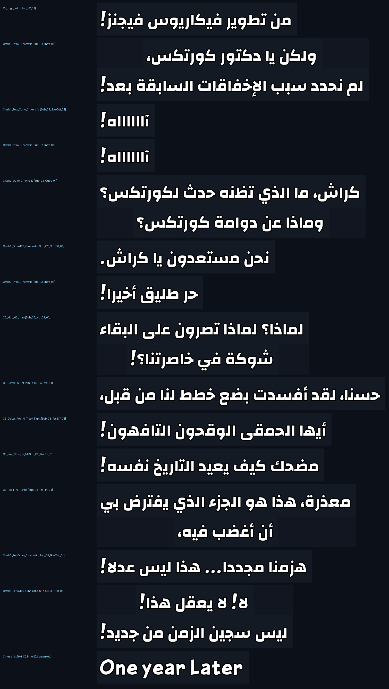

# Crash Bandicoot N. Sane Trilogy — التعريب الكامل (إصدار الكمبيوتر)

تعريب كامل واحترافي للعبة **Crash Bandicoot N. Sane Trilogy** على منصة Steam (الإصدار **`v1.1.0`**)، يغطي القوائم، الإعدادات، التلميحات، الرسوميات، شاشات البداية، النصوص ثنائية وثلاثية الأبعاد (2D & 3D VFX)، **والترجمة النصية العربية داخل اللعبة لجميع المشاهد السينمائية الناطقة الـ 14** مع عرض عربي سليم من اليمين إلى اليسار (**RTL**) وربط كامل للحروف.


---

## الجديد في الإصدار `v1.1.0`

- **ترجمة نصية متزامنة داخل اللعبة لـ `14` مشهدًا سينمائيًا ناطقًا** (**`96` لوحة ترجمة** موزعة بدقة على **`44` لقطة `_ui.igz`** بخط **Changa** الأبيض المحدد بإطار أسود `GeekSpeak_Outline` دون لمس أي أرشيفات أصلية):
  - **شعار البداية**: `VV_Logo_Intro` (`2` لوحتان)
  - **Crash Bandicoot 1**: `Crash1_Intro_Cinematic` (`11` لوحة) + `Crash1_Boss_Outro_Cinematic` (`2` لوحتان) *(ومشهد `Crash1_Outro_Cinematic` صامت بالكامل)*
  - **Crash Bandicoot 2**: `Crash2_Intro_Cinematic` (`14` لوحة مع الحفاظ على لوحة `"بعد عام واحد"`) + `Crash2_Outro_Cinematic` (`2` لوحتان) + `Crash2_Outro100_Cinematic` (`2` لوحتان)
  - **Crash Bandicoot 3: Warped**: `Crash3_Intro_Cinematic` (`27` لوحة) + **مشاهد غرفة الزمن الـ 5 (`EDC`)**: `C3_Hub_02_Intro` (`4`), `C3_Cortex_Taunt_2` (`3`), `C3_Cortex_Post_N_Tropy_Fight` (`4`), `C3_Post_NGin_Fight` (`6`), `C3_Pre_Final_Battle` (`7`) + `Crash3_BossOutro_Cinematic` (`5`) + `Crash3_Outro100_Cinematic` (`7`)
- **السجل الثنائي اللغة الكامل للمشاهد والحوارات ([reports/DIALOGUES_AND_CUTSCENES_AR.md](reports/DIALOGUES_AND_CUTSCENES_AR.md)):** تفريغ وترجمة جميع المقاطع الصوتية الـ **`48`** (`35` حوار `TalkingHeads` في غرف الانتقال لكراش 2 و3 + `13` عبارة للشاشات والزعماء) إلى جانب جدول ترجمات المشاهد السينمائية الـ `96`.
  - *ملاحظة تقنية حول `TalkingHeads`:* تُستدعى حوارات غرف الانتقال (`L200_Hub` / `L300_Hub`) برمجيًا عبر عقد `VSC` ولا يمتلك محرك اللعبة نداء `VSC` موصولًا بـ `CGuiEventSubtitlesShow` في الأصل؛ ولذا أبقينا الـ Hubs خاليةً من حقن بايتكود غير مختبر مع إتاحة النص المترجم الكامل في التقرير وملف JSON المرفق.



---

## المميزات الأساسية للتعريب

- **تعريب غير مدمر (Non-Destructive Mod):** لا يلمس أرشيفات اللعبة الـ 171 الأصلية (`.pak`) ولا يمس الملف التنفيذي أو ملفات الحفظ (Steam Saves)؛ يعتمد كليًا على طبقة التجاوز الرسمية `archives\update.pak` (`672` مدخلًا مضغوطًا).
- **تغطية واجهة شاملة:** ترجمة **627 نصًا فريدًا** (**1,311 خانة نصية** موزعة على **419 ملف لغة `_en.lng`**) مع الحفاظ على المعرّفات الداخلية وأسماء العلامات التجارية الثابتة.
- **عرض عربي متصل ومرتب (RTL):** تشكيل مسبق عبر `arabic-reshaper` + خوارزمية `BiDi` (`python-bidi`) مع التفاف أسطر منطقي يسبق العكس البصري، وحماية كاملة للمتغيرات (`{0}`, `%s`, `%d`, `%c%d`, `%.2f %%`, `%llu`) وأيقونات أزرار التحكم (`\uE000–\uF8FF`).
- **خطوط عربية عالية الدقة (SIL OFL 1.1):**
  - **Cairo** (`Cairo-Bold`) للقوائم والمعلومات والتلميحات (`ProximaNova-Info`, `ProximaNova-Title`).
  - **Changa** (`Changa-Bold`, `Changa-ExtraBold`) للعناوين الرئيسية، اللافتات الكرتونية، الترجمة النصية للمشاهد، والنصوص ثلاثية الأبعاد (`GeekSpeak*`, `zoinks*`, `VFX_TEXT_LG*`).
  - تغطية كاملة لـ **11 خط واجهة 2D** + **أطالس النصوص ثلاثية الأبعاد 3D VFX** (`BC3_UNORM` و `BC5_UNORM` بـ 9 مستويات Mipmap) مع **صفر محارف مفقودة**.


---

## طريقة التثبيت (للاعبين)

1. انتقل إلى صفحة [**Releases**](../../releases) وحمّل آخر إصدار جاهز (**`CrashNST-Arabic-v1.1.0.zip`**).
2. فك ضغط الملف في أي مجلد على جهازك.
3. تأكد من إغلاق اللعبة بالكامل ومن بقاء لغة اللعبة في Steam مضبوطة على **English**.
4. شغّل **`Install-Arabic.bat`** (انقر بزر الفأرة الأيمن واختر *Run as administrator* إذا طُلب ذلك).
5. سيكتشف المثبّت مجلد اللعبة تلقائيًا، ويتحقق من سلامة الحزمة وملفات اللعبة الأساسية ببصمة `SHA-256`، ثم يثبّت `archives\update.pak`.

### إزالة التعريب وإعادة اللعبة لأصلها
- أغلق اللعبة ثم شغّل **`Uninstall-Arabic.bat`**.
- يتم حذف `archives\update.pak` (أو استعادة نسختك الأصلية المحفوظة في `_arabic_backup/` إن وُجدت) والتحقق من تطابق ملفات اللعبة الأصلية.

---

## البناء من المصدر (للمطورين)

### المتطلبات
```bash
python -m venv .venv
.venv\Scripts\activate
pip install -r requirements.txt
```
- ضع أداة Microsoft DirectXTex [`texconv.exe`](https://github.com/microsoft/DirectXTex/releases) داخل `workspace/tools/texconv.exe`.
- حمّل خطي **Cairo** و **Changa** (برخصة `SIL OFL 1.1`) وصحّح جدول `cmap` لنطاق Presentation Forms-B عبر:
  ```bash
  python scripts/13_setup_arabic_fonts.py
  python scripts/14_patch_arabic_fonts_cmap_and_verify.py
  ```
- لبناء حزمة الواجهة الأساسية ثم دمج ترجمات جميع المشاهد الـ 14 وإنتاج `package/data/update.pak` وتحديث `package/manifest.json`:
  ```bash
  python scripts/27_build_full_arabic_update.py
  python scripts/build_complete_arabic_update.py
  ```

---

## شكر وتنويه

- **التطوير والتنفيذ:** `V7dt1 / axxx503`
- **الخطوط المفتوحة المصدر:** [Cairo](https://github.com/Gue3bara/Cairo) و [Changa](https://github.com/googlefonts/changa-vf) مرخصتان بموجب [SIL Open Font License 1.1](package/OFL.txt).
- **إخلاء المسؤولية:** هذا المشروع عمل مجتمعي غير رسمي لتعريب اللعبة ولا يحتوي على أي ملفات تنفيذية معدّلة أو أدوات تجاوز حماية؛ يُشترط امتلاك نسخة أصلية من اللعبة.
