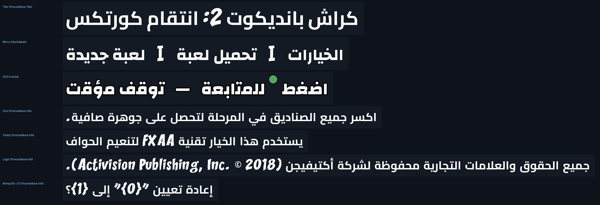
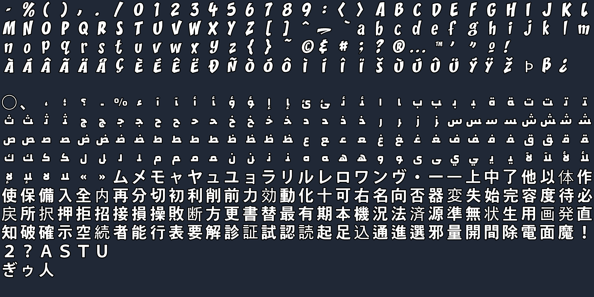

# Crash Bandicoot N. Sane Trilogy — التعريب الكامل (إصدار الكمبيوتر)

تعريب كامل واحترافي للعبة **Crash Bandicoot N. Sane Trilogy** على منصة Steam، يغطي القوائم، الإعدادات، التلميحات، الرسوميات، شاشات البداية، وتقريباً جميع العناوين والنصوص داخل اللعبة مع عرض عربي سليم من اليمين إلى اليسار (**RTL**) وربط كامل للحروف وخطوط عربية ثنائية وثلاثية الأبعاد (2D & 3D VFX).



---

## المميزات الرئيسية

- **تعريب غير مدمر (Non-Destructive Mod):** لا يلمس أرشيفات اللعبة الـ 171 الأصلية (`.pak`) ولا يمس الملف التنفيذي أو ملفات الحفظ (Steam Saves)؛ يعتمد كلياً على طبقة التجاوز الرسمية `archives\update.pak`.
- **تغطية شاملة:** ترجمة **627 نصاً فريداً** (**1,311 خانة نصية** موزعة على **419 ملف لغة `_en.lng`**) مع الإبقاء على المعرّفات الداخلية وأسماء العلامات التجارية الثابتة كما هي.
- **عرض عربي متصل ومرتب (RTL):** تشكيل مسبق عبر `arabic-reshaper` + خوارزمية `BiDi` (`python-bidi`) مع التفاف أسطر منطقي يسبق العكس البصري، وحماية كاملة للمتغيرات (`{0}`, `%s`, `%d`, `%c%d`, `%.2f %%`, `%llu`) وأيقونات أزرار التحكم (`\uE000–\uF8FF`).
- **خطوط عربية عالية الدقة (SIL OFL 1.1):**
  - **Cairo** (`Cairo-Bold`) للقوائم والمعلومات والتلميحات (`ProximaNova-Info`, `ProximaNova-Title`).
  - **Changa** (`Changa-Bold`, `Changa-ExtraBold`) للعناوين الرئيسية واللافتات الكرتونية والنصوص ثلاثية الأبعاد (`GeekSpeak*`, `zoinks*`, `VFX_TEXT_LG*`).
  - تغطية كاملة لـ **11 خط واجهة 2D** + **أطالس النصوص ثلاثية الأبعاد 3D VFX** (`BC3_UNORM` و `BC5_UNORM` بـ 9 مستويات Mipmap) مع **صفر محارف مفقودة**.



---

## طريقة التثبيت (للاعبين)

1. انتقل إلى صفحة [**Releases**](../../releases) وحمّل آخر إصدار جاهز (`CrashNST-Arabic-v1.0.0.zip`).
2. فك ضغط الملف في أي مجلد على جهازك.
3. تأكد من إغلاق اللعبة بالكامل ومن بقاء لغة اللعبة في Steam مضبوطة على **English**.
4. شغّل **`Install-Arabic.bat`** (انقر بزر الفأرة الأيمن واختر *Run as administrator* إذا طُلب ذلك).
5. سيكتشف المثبّت مجلد اللعبة تلقائياً، ويتحقق من سلامة الحزمة وملفات اللعبة الأساسية ببصمة `SHA-256`، ثم يثبّت `archives\update.pak`.

### إزالة التعريب وإعادة اللعبة لأصلها
- أغلق اللعبة ثم شغّل **`Uninstall-Arabic.bat`**.
- يتم حذف `archives\update.pak` (أو استعادة نسختك الأصلية المحفوظة في `_arabic_backup/` إن وُجدت) والتحقق من تطابق ملفات اللعبة الأصلية.

---

## البناء من المصدر (للمطورين)

### المتطلبات
```bash
python -m venv .venv
.venv\Scripts\activate
pip install -r requirements.txt
```
- ضع أداة Microsoft DirectXTex [`texconv.exe`](https://github.com/microsoft/DirectXTex/releases) داخل `workspace/tools/texconv.exe`.
- حمّل خطي **Cairo** و **Changa** (برخصة `SIL OFL 1.1`) وصحّح جدول `cmap` لنطاق Presentation Forms-B عبر:
  ```bash
  python scripts/13_setup_arabic_fonts.py
  python scripts/14_patch_arabic_fonts_cmap_and_verify.py
  ```
- لبناء أرشيف `package/data/update.pak` المضغوط والتحقق من سلامة جميع الخطوط والأصول:
  ```bash
  python scripts/27_build_full_arabic_update.py
  python scripts/28_generate_manifest.py
  ```

---

## شكر وتنويه

- **التطوير والتنفيذ:** `V7dt1 / axxx503`
- **الخطوط المفتوحة المصدر:** [Cairo](https://github.com/Gue3bara/Cairo) و [Changa](https://github.com/googlefonts/changa-vf) مرخصتان بموجب [SIL Open Font License 1.1](package/OFL.txt).
- **إخلاء المسؤولية:** هذا المشروع عمل مجتمعي غير رسمي لتعريب اللعبة ولا يحتوي على أي ملفات تنفيذية معدّلة أو أدوات تجاوز حماية؛ يُشترط امتلاك نسخة أصلية من اللعبة.
